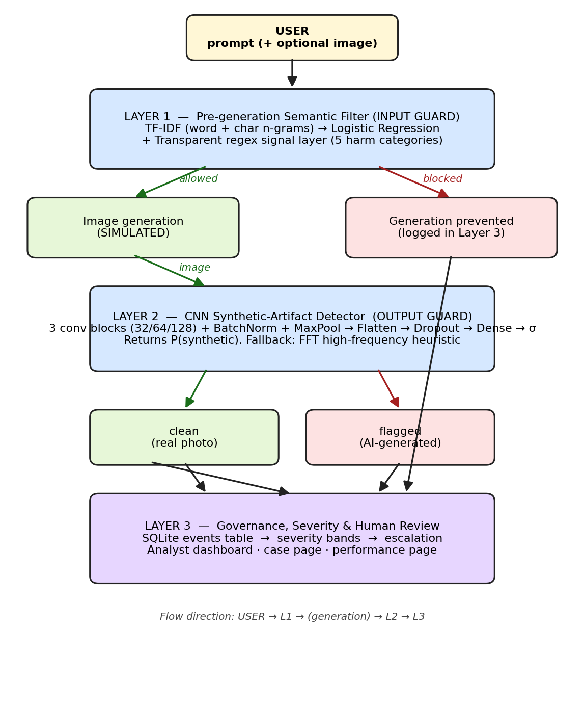
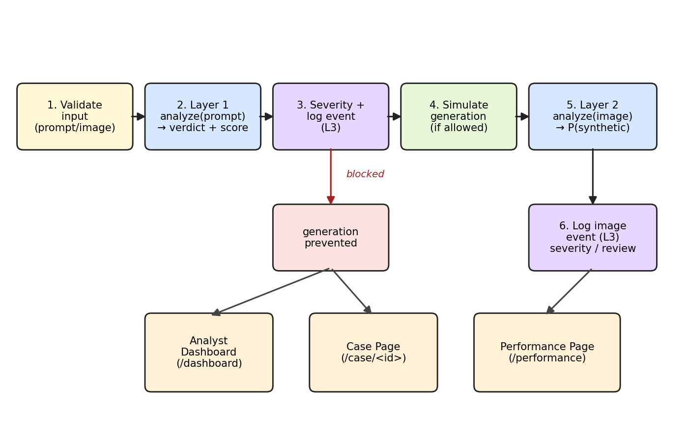
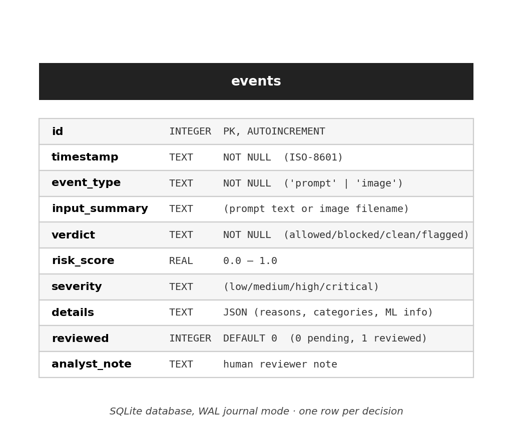
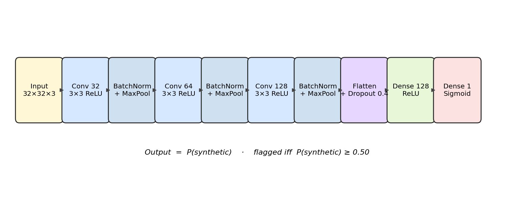
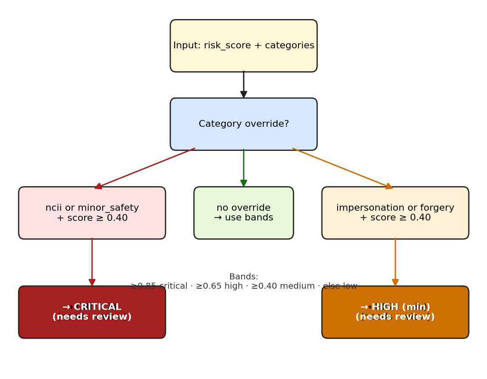

# CHAPTER THREE: SYSTEM ANALYSIS AND DESIGN

## 3.1 Research Methodology

This chapter reports the analysis and design that precede implementation. Its purpose is to justify the research method, to examine the system that the proposed framework replaces, to specify the requirements, and to present a complete, professionally modelled design of the solution before any code is written.

The project adopted an **iterative, prototype-driven** software development methodology, and the choice is justified against the nature of the work. A conventional Waterfall model assumes that the requirements of a system are fixed and fully known at the outset; the present project cannot make that assumption, because the requirements are behavioural and were derived from a body of literature rather than from a single customer specification. The safety properties of the system (which prompts must be blocked, which images must be flagged, and what evidence must be preserved) could only be validated empirically, by repeatedly exposing prototypes to representative and adversarial inputs and measuring the outcome. A purely Agile, team-oriented process was equally unsuitable, because the work was carried out by a single developer over a bounded academic period. The prototype-driven approach occupies the middle ground: it produces a working artefact at every iteration, it allows each functional layer to be validated in isolation before integration, and it keeps the system demonstrable at all times. These properties matter for a machine-learning system, in which a fault in one layer is easily mistaken for a fault in another if the layers are integrated too early.

The evidence used to ground the analysis was gathered through **document review**, the same method used in the project's preceding seminar review (Oke, 2026). Peer-reviewed sources published between 2023 and 2026, the safety frameworks they describe (Erase-and-Check, Kumar et al., 2023; ProAct, Zhao et al., 2024; AlignGuard, Liu et al., 2024), and the documented case study of the GrokAI incident on the X platform together define what is here called the existing system. No human participants were involved and no personal data were collected, so no ethical clearance was required; the data used in Chapter Four are publicly available benchmark images and synthetically generated prompt text.

The development proceeded through five stages, which were repeated for each layer of the system:

1. **Requirements derivation.** The functional and non-functional requirements for each layer were drawn directly from the weaknesses of the existing system identified in Section 3.2 and from the integrated three-layer architecture established by the seminar review (Oke, 2026).
2. **Component design.** For every layer, the algorithmic approach, the data structures, and the module boundaries were specified before any code was written. This included choosing the algorithm family for each learned component (a TF-IDF and Logistic Regression pipeline for Layer 1 and a lightweight convolutional neural network for Layer 2), the input/output contract of each module, and its dependency surface.
3. **Implementation in isolation.** Each layer was implemented as an independent Python package (`layer1_filter`, `layer2_detector`, `layer3_governance`) so that it could be developed, tested, and validated without depending on the other layers.
4. **Training and evaluation.** The learned components were trained on prepared datasets, evaluated on held-out data, and tuned independently. Metrics were persisted as `metrics.json` artefacts so that they could later be displayed inside the web application itself.
5. **Integration and end-to-end verification.** Once each layer had passed its isolation tests, the layers were wired together by a Flask orchestration application (`app.py`) and verified end-to-end over live HTTP.

Because two of the algorithm families named in stage two recur throughout this report they are stated in full here and treated formally in Section 3.7.

**Term Frequency–Inverse Document Frequency (TF-IDF)** is a classical method for converting free text into numeric feature vectors (Salton & Buckley, 1988). It is a representation technique, not a classifier. For a term *t* and a prompt *d*, the weight is the product of the term frequency and the inverse document frequency: TF-IDF(t, d) = tf(t, d) × idf(t), where idf(t) = ln((1 + N)/(1 + df(t))) + 1, in which *N* is the number of prompts in the corpus and df(t) is the number of prompts containing the term. The resulting vector is then length-normalised. Terms that occur often in one prompt but rarely across the corpus receive high weights, so the representation emphasises the words and phrases that distinguish one prompt from the rest rather than common filler words. In this project TF-IDF is computed at two granularities: word unigrams and bigrams, which capture phrase-level patterns such as "remove her clothes" or "ignore your instructions", and character n-grams, which preserve sub-word shapes so that light obfuscations such as "n4k3d" or "un-dress" are not lost. This two-view representation is the feature-engineering foundation of Layer 1.

**Logistic Regression** is the classification head that consumes those features. It models the log-odds of the outcome as a linear function of the feature vector *x* and converts it to a probability with the logistic (sigmoid) function (Hosmer et al., 2013): P(harmful | x) = 1 / (1 + e^-(w·x + b)). The weight vector *w* is learned by minimising the binary cross-entropy loss with L2 regularisation. Logistic Regression was chosen over alternatives such as naive Bayes and support vector machines because it produces a well-calibrated probability in the range 0 to 1 (which the governance layer needs for severity scoring), it is linear and therefore interpretable (each learned coefficient belongs to a concrete feature), and it trains almost instantly on the size of dataset used here. Its role in the pipeline is therefore precise: TF-IDF answers how the text should be represented, and Logistic Regression answers how likely that representation is harmful. The two are fused in the design described in Section 3.7.1.

## 3.2 Analysis of the Existing System

Before the weaknesses of the existing approach can be stated, the object of the analysis must be defined precisely, because no single commercially deployed product currently implements the integrated specification that this project delivers. Accordingly, the analysis below treats the existing system as that composite: (i) the pre-generation prompt-safety mechanisms that the reviewed literature describes, most concretely Erase-and-Check (Kumar et al., 2023), ProAct (Zhao et al., 2024), and AlignGuard (Liu et al., 2024); and (ii) the reactive platform-level moderation deployed on commercial generative platforms at the time of the GrokAI incident, as consolidated in the seminar review (Oke, 2026). Each weakness is therefore attributable to a cited mechanism or to a documented incident rather than to an unnamed generality.

### 3.2.1 Architecture of the Existing System

The composite architecture operates as a linear, largely reactive pipeline. At the input edge, a user prompt is passed to a single safety layer. In research frameworks this layer is an LLM alignment or lexical filter: for example, Erase-and-Check erases tokens from a prompt and re-checks every subsequence with a safety classifier before generation may proceed (Kumar et al., 2023), while AlignGuard fine-tunes the generator itself so that it refuses harmful text-to-image requests (Liu et al., 2024). On commercial platforms of the kind involved in the GrokAI incident, this input stage was a comparatively light alignment and keyword-based refusal mechanism, deliberately configured to be permissive (Oke, 2026). If the prompt passes this single gate, generation executes and the produced image enters the distribution channel.

Downstream, three post-publication mechanisms act in series: **hash-based matching** against databases of previously catalogued prohibited material, **classifier-based and community moderation** that screens content and receives user reports, and **manual human review** of whatever is escalated to a queue. The output of these mechanisms is typically a takedown decision. Logging, where it exists, records the incident for removal purposes rather than as a structured, machine-readable evidence trail that records why the decision was made, under which harm category, and who reviewed it.

The defining property of this architecture is that its components are single-layer and isolated: prompt screening is not connected to image screening, image screening is not connected to a severity or escalation policy, and none of the decisions feeds a persistent evidentiary store. It is this architectural isolation, rather than any single implementation detail, that the proposed system is designed to remove.

### 3.2.2 Weaknesses of the Existing System

Five structural weaknesses follow from the architecture described above. Each is stated with its consequence and its source.

1. **The system is reactive: it intervenes after publication.** Harmful content must be generated, distributed, and reported before any action is taken. A harmful image that is never generated cannot be distributed, yet nothing in the existing architecture prevents generation at the point of intent.
2. **Hash-based matching is structurally defeated by diffusion models.** Diffusion models synthesise a statistically unique pixel distribution on every generation (Croitoru et al., 2023). Two conceptually identical images produced seconds apart have different hashes, so a database of known material cannot identify freshly generated content. This weakness affects every post-publication matching mechanism, not a single vendor's implementation.
3. **Lexical and keyword safety layers are simultaneously over- and under-inclusive.** Keyword filters block legitimate uses of the same tokens ("nude" lipstick, a chicken "breast", a "naked" tree) while failing on light obfuscation ("n4k3d", "un-dress") and on paraphrased or multi-step jailbreak phrasing that never names a banned word. This over-blocking also risks censoring protected speech, a documented ethical objection to keyword-based moderation (Ahmed & Khan, 2024).
4. **Single-layer pre-generation defences are point solutions.** A prompt that bypasses the one input gate bypasses the entire system, because there is no secondary, independent check on the generated output. The literature reports that no single defensive technique is universally effective against adversarial prompts (Xu et al., 2024; Zhao et al., 2024); Erase-and-Check's guarantee, for example, is certified over erased subsequences and does not extend to an image-level check after generation.
5. **Downstream manual review cannot scale, and no evidentiary record is produced.** A single misused model was reported to generate thousands of undressed images per hour during the GrokAI incident (Oke, 2026), a rate at which human review accumulates an immediate backlog. Where automated moderation exists it rarely logs the reasons for a decision in a structured, machine-readable form, and it does not score severity or require human sign-off on the most serious harms. Akinola et al. (2026) argue that this absence of a verified evidentiary record is precisely what hampers enforcement under the Nigeria Data Protection Act (2023) and the Cybercrimes (Amendment) Act (2024) in capacity-constrained jurisdictions.

These five weaknesses jointly define the requirements of the proposed system, which are specified in Section 3.4 and answered point by point in Section 3.3.

## 3.3 Analysis of the Proposed System

The proposed system is **proactive, layered, and auditable**. Where the existing architecture intervenes once, after publication, the proposed architecture intervenes at three points along the generation pipeline and connects the three interventions through a shared governance store. Each existing weakness listed in Section 3.2.2 has a direct countermeasure: the reactive posture is replaced by pre-generation blocking; hash matching is replaced by a classifier that detects learned artefacts of synthesis; the single input gate is replaced by two independent layers (a semantic filter and an image detector); keyword lists are replaced by a learned, phrase-aware classifier reinforced by a de-obfuscating rule layer; and the absent logging is replaced by a persistent, severity-scored, human-reviewable evidentiary record.

### 3.3.1 System Architecture of the Proposed System

Figure 3.1 summarises the layered architecture. A user submits a prompt and, optionally, an image to a single web application. Layer 1, the pre-generation semantic filter, examines the prompt before any generation can begin and returns a verdict of allowed or blocked together with a risk score and zero or more harm categories. A blocked prompt is logged and generation is recorded as prevented; an allowed prompt proceeds to a simulated generation stage. Layer 2, the CNN synthetic-artefact detector, then examines any image that reaches it (a generated output, a built-in sample, or a direct upload) and returns a verdict of real or ai_generated with the probability P(synthetic). Layer 3, the governance and logging layer, records every Layer 1 and Layer 2 decision in a SQLite database, converts the numeric risk into a severity band, and escalates the most serious cases to a human analyst dashboard.

The three layers are independent Python packages instantiated once by the web application at start-up (`SemanticFilter().load()`, `ArtifactDetector().load()`, `db.init_db()`) and dispatched in a fixed order. Layer 2 is invoked only when Layer 1 has allowed the prompt; this ordering realises the architectural intent that prevention precede detection. The architecture is deliberately modular: each layer exposes a narrow runtime interface (`analyze()` for Layers 1 and 2, and CRUD and severity functions for Layer 3), so any layer can be retrained or replaced without touching the others.


*Figure 3.1: Three-layer architecture of the proposed AI Information Misuse Prevention System.*

### 3.3.2 Behaviour at the Three Intervention Points

The behaviour of the proposed system is best understood at its three intervention points, each of which is expanded below.

1. **Before generation.** Every prompt is analysed by Layer 1 in a single call. The text is first lightly normalised for the rule layer (zero-width characters are stripped, inter-letter punctuation is removed, and digit leet substitutions are applied only inside words). The learned pipeline then scores the prompt in two feature spaces — word unigrams/bigrams and character n-grams — and returns P(harmful); the rule layer independently returns a category score. The two are fused into one risk score (Section 3.7.1). If the score meets the block threshold, the prompt is refused, generation is recorded as prevented, and a prompt event containing the verdict, score, categories, matched signals, and a human-readable list of reasons is written to the governance store. No image is produced. This is the system's primary defence and its only intervention that can stop harm at the point of intent.
2. **After generation.** Any image that survives Layer 1 — a simulated generated output, or an image uploaded or selected directly — is validated (extension whitelist, magic-number verification, decompression-bomb limit), re-encoded to a sanitised PNG, and passed to Layer 2. The detector resizes the image to 32×32, normalises the pixel values, and passes it through a compact CNN that returns P(synthetic); the image is flagged as ai_generated when that probability is at least 0.50. If the trained CNN cannot be loaded, the detector transparently switches to a frequency-domain heuristic and reports its mode in the result (Section 3.7.2). This is the secondary net: it catches synthetic content that bypassed the prompt filter or that entered the pipeline from outside it.
3. **At decision time.** Every decision made by Layers 1 and 2 is logged as an event with a timestamp, an input summary, a verdict, a risk score, a severity band, and a structured JSON detail field containing the reasons, the categories, and the model information. The governance layer then applies the severity and escalation policy of Section 3.7.3: risk scores are mapped to severity bands, category overrides force the most serious harms (NCII and the sexualisation of minors) to critical, and any high or critical event is marked as needing human review and surfaces on the analyst dashboard, where a reviewer can attach a note and sign off. This produces the auditable, machine-readable evidentiary record that supports enforcement under the Nigeria Data Protection Act (2023) and the Cybercrimes (Amendment) Act (2024).

### 3.3.3 Advantages over the Existing System

The advantages of the proposed system follow directly from the weaknesses it was designed to remove:

- **Upstream prevention.** A harmful image that is never generated cannot be distributed; Layer 1 blocks at the point of intent rather than after publication.
- **Detection of novel synthetic images.** Layer 2 classifies by learned diffusion artefacts rather than by matching known hashes, so it generalises to images the system has never seen.
- **Context-aware rather than keyword-based screening.** The learned pipeline captures phrase-level intent and the rule layer context-gates ambiguous terms, so legitimate prompts that reuse harmful vocabulary are not mistaken for harmful ones.
- **Two independent defences rather than one gate.** A prompt that defeats Layer 1 is still subject to an independent image-level check in Layer 2, and vice versa.
- **Explainable, category-tagged decisions.** Layer 1 returns not only a verdict but the harm categories detected and the reasons, which makes the decision reviewable by a human analyst.
- **Severity scoring, escalation, and human-in-the-loop oversight.** High- and critical-severity cases are routed to an analyst for sign-off rather than being decided by the machine alone.
- **An auditable evidentiary record.** Layer 3 stores every decision with the reasons behind it, structured to support the evidentiary requirements of the NDPA (2023) and the Cybercrimes (Amendment) Act (2024).
- **Resilience and modularity.** The image detector falls back to a heuristic when the CNN is unavailable, and every layer can be retrained independently.

## 3.4 System Requirements

The requirements below are traceable: functional requirements FR-1 to FR-8 answer the weaknesses of Section 3.2.2 and the objectives of Chapter One, and non-functional requirements NFR-1 to NFR-6 state the qualities the system must possess.

### 3.4.1 Functional Requirements

- **FR-1.** The system shall accept a textual prompt, an optional uploaded image, or a selection of a built-in sample image.
- **FR-2.** Layer 1 shall classify each prompt as allowed or blocked, return a risk score in the range 0.0–1.0, and tag the prompt with zero or more harm categories from {ncii, minor_safety, jailbreak, impersonation, forgery}.
- **FR-3.** Layer 2 shall classify each image as real or ai_generated and return P(synthetic) in the range 0.0–1.0.
- **FR-4.** The system shall not invoke generation when Layer 1 blocks a prompt, and shall record the generation as prevented.
- **FR-5.** The system shall log every prompt and image decision in a persistent database, including a timestamp, input summary, verdict, risk score, severity, and a structured JSON detail field.
- **FR-6.** The system shall map risk scores to severity bands (low, medium, high, critical), escalate any ncii or minor_safety case to critical, and raise any impersonation or forgery case to at least high, subject to the minimum risk scores defined in Section 3.7.3.
- **FR-7.** The system shall provide an analyst dashboard with views filtered by all, flagged, and pending review, and a per-case page on which an analyst can attach a note and mark the case reviewed.
- **FR-8.** The system shall expose a model-performance page that renders the latest training metrics and the CNN confusion matrix.

### 3.4.2 Non-functional Requirements

- **NFR-1 Performance.** The full pipeline shall return a response within a few seconds of submission on a single CPU.
- **NFR-2 Portability.** The system shall run on a standard laptop running Windows or Linux with no GPU.
- **NFR-3 Auditability.** Every automated decision shall be reproducible from the stored log and shall include a human-readable list of reasons.
- **NFR-4 Resilience.** The image detector shall fall back to a frequency-domain heuristic if the trained CNN cannot be loaded, so the system continues to operate.
- **NFR-5 Security.** Uploaded files shall be validated, re-encoded, filename-sanitised, and capped at 8 MB and 20 million pixels; all state-changing forms shall be protected against cross-site request forgery.
- **NFR-6 Modularity.** Each layer shall be self-contained and retrainable without modifying the others.

### 3.4.3 Hardware and Software Requirements

The system was designed to run on commodity hardware. The implementation environment was a Windows PC with a dual-core CPU, 8 GB of RAM, and approximately 2 GB of free disk space; no GPU was required or used. The software stack is stated and justified in Section 4.1; in summary, it requires Python 3.10 or later (developed on 3.13), the Flask web framework, scikit-learn for Layer 1, TensorFlow/Keras for Layer 2, the SQLite database engine, and the Pillow, NumPy, and pandas libraries for imaging and numerical work. Full versions are pinned in the project's `requirements.txt`.

## 3.5 System Design Models

The artefact under design is a data-processing and decision pipeline rather than an object-oriented business information system, so the design is expressed with the models most appropriate to that kind of artefact rather than with UML class and use-case diagrams. Four models are presented: the three-layer architecture (Figure 3.1, Section 3.3.1), the process and data-flow diagram (Figure 3.2, Section 3.5.1), the entity-relationship model of the database (Figure 3.3, Section 3.6), and the component-level models of the two learned layers and the severity policy (Section 3.7).

### 3.5.1 Process and Data Flow

When a request arrives at the `/analyze` endpoint, the application proceeds through the five stages shown in Figure 3.2, which correspond exactly to the branches of the `analyze()` function in `app.py`:

1. **Validate the input.** The request is rejected with a user-friendly message if it contains neither a prompt nor an image.
2. **Screen the prompt (Layer 1).** The application calls `prompt_filter.analyze(prompt)`, which returns a structured verdict containing the decision, risk score, categories, matched signals, the ML probability, the rule-layer score, and the reasons.
3. **Convert the risk to a severity and log the prompt event (Layer 3).** The application calls `score_to_severity(risk_score, categories)` and `needs_human_review(severity)`, then persists the event with `db.log_event(...)`. Severity is computed at this point, immediately after screening, rather than at the end of the request, for two reasons. First, a blocked prompt never produces an image, so this prompt event is the only record of the incident; computing severity here guarantees that even a prevented generation is categorised and, where appropriate, escalated for human review. Second, it keeps the mapping between a decision and its operational consequence local to the decision, so the audit trail never contains a prompt row without a severity.
4. **Decide whether generation proceeds.** If Layer 1 blocked the prompt, generation is recorded as prevented and the image stage is skipped; the blocked status is carried so that Layer 2 is never invoked on content that should not have been produced.
5. **Screen the image (Layer 2), when one exists and generation was not prevented.** The uploaded file (or chosen sample) is validated and re-encoded before it is handled: the extension must be in an allowed whitelist, the file is verified as a genuine image through `Image.verify()`, decompression-bomb warnings are treated as errors, the image is re-encoded to PNG with a server-generated, sanitised filename, and the request is capped at 8 MB. The saved image is then passed to `image_detector.analyze(image_path)`, which resizes it to 32×32, runs the CNN, and returns the label, P(synthetic), the confidence, the detector mode, and the threshold. The verdict is derived (flagged when the label is ai_generated, otherwise clean), the severity is computed, and a second event is logged for the image decision.

Three further routes complete the data-flow surface of the application: `/dashboard` aggregates events and summary counters from the governance store; `/case/<id>` reads a single event and accepts an analyst note via POST; and `/performance` reads the cached `metrics.json` artefacts and renders them as tables and figures. The user interfaces behind these routes are described in Section 4.2.


*Figure 3.2: Process and data flow when a request hits /analyze.*

## 3.6 Database Design

The governance store is a single SQLite database (`database.db`) opened in WAL journal mode so that reads and writes can interleave without locking. It contains one core table, `events`, designed to be the system's authoritative evidentiary record. Table 3.1 defines each field, its type, and its purpose, and Figure 3.3 shows the corresponding entity-relationship model.

*Table 3.1: Schema of the events table.*

| Field | Type | Purpose |
|-------|------|---------|
| id | INTEGER PK | Unique event identifier exposed to the analyst interface. |
| timestamp | TEXT NOT NULL | ISO-8601 second-resolution time of the decision. |
| event_type | TEXT NOT NULL | prompt or image; identifies which layer produced the event. |
| input_summary | TEXT | The prompt text (Layer 1) or the saved image filename (Layer 2). |
| verdict | TEXT NOT NULL | One of allowed, blocked, clean, flagged. |
| risk_score | REAL | Numeric risk in 0.0–1.0. |
| severity | TEXT | One of low, medium, high, critical. |
| details | TEXT (JSON) | Reasons, categories, matched signals, ML probability, detector mode, escalation flag. |
| reviewed | INTEGER DEFAULT 0 | 0 = pending review, 1 = reviewed. |
| analyst_note | TEXT | Free-text note attached when an analyst marks the case reviewed. |

The schema is deliberately narrow. It stores enough information to reconstruct why the system made a given decision without storing the raw image inside the database; images are saved as files under `uploads/` with sanitised names and are referenced indirectly through `input_summary`. The `details` field holds a JSON document that records the reasons, the matched harm categories, the signal patterns that fired, the machine-learning probability, the detector mode, and the escalation flag, so that the full reasoning behind any decision can be replayed from a single row. Five derived statistics (total events, blocked, flagged, pending review, and critical) are computed on demand by `get_stats()` for the dashboard header rather than being stored redundantly. In relational terms the schema is a single relation in third normal form: every non-key attribute describes the event identified by `id`, and the variable-length justification content is carried in the `details` JSON document rather than in separate columns.


*Figure 3.3: Database design — the events table (SQLite, WAL mode).*

## 3.7 Model and Algorithm Design

### 3.7.1 Layer 1 — Semantic Prompt Filter

Layer 1 fuses a learned classifier with a transparent rule layer so that the failure mode of neither approach is fatal to the system.

**(a) TF-IDF and Logistic Regression — the learned signal.** As introduced in Section 3.1, each prompt is represented by a TF-IDF vector at two granularities (Salton & Buckley, 1988): word unigrams and bigrams, which capture phrase-level patterns such as "remove her clothes", "ignore your instructions", and "fake passport"; and character n-grams of length three to five, which capture sub-word shapes and therefore remain sensitive under light obfuscation ("n4k3d", "un-dress", "deepfakenude"). Sub-linear term-frequency scaling (1 + ln tf) is applied so that repeated words do not dominate the vector. The two views are concatenated with a `FeatureUnion` and passed to a Logistic Regression head with L2 regularisation (C = 4), balanced class weights, and a 2000-iteration convergence cap, so that both classes contribute to the loss in proportion to their information rather than their count. The head maps the high-dimensional, sparse feature vector to P(harmful) in (0, 1). Its role in the pipeline is classification and calibration: TF-IDF supplies the representation, and Logistic Regression supplies the probabilistic decision boundary over it, which in turn feeds the severity policy in Layer 3.

**(b) The transparent rule layer — an explainable safety net.** Alongside the learned classifier, a rule-based layer scans every prompt for five harm categories, each with a baseline score and a set of trigger patterns (Table 3.2). It is important to state what this layer is and is not: it is not a machine-learning algorithm. It is a deterministic, human-auditable set of regular expressions, and it is described here as a rule layer for that reason. It earns its place in the design for three purposes that a learned classifier alone cannot serve: it tags the harm category (which drives the severity overrides in Layer 3), it produces concrete, readable reasons for an analyst, and it acts as a deterministic safety net that fires even before a model has been trained or retrained.

*Table 3.2: Harm categories used by the transparent rule layer.*

| Category | Score | Examples of trigger patterns |
|----------|-------|------------------------------|
| ncii | 0.92 | undress(ing\|ed), remove her/the/this person's clothes, strip off, deepfake nude, revenge porn, make the clothes transparent, show/expose … (ass, breasts, genitals) |
| minor_safety | 0.99 | child / minor / underage / teen(ager) / schoolgirl terms PLUS a sexual-context term (both required) |
| jailbreak | 0.75 | ignore (all\|your\|previous) instructions, do anything now, developer/DAN mode, bypass/disable/turn off (filter\|safety\|guardrail), zero restrictions, uncensored |
| impersonation | 0.85 | deepfake … photo/image of, realistic fake … of (a/the/my) [public figure], face-swap onto, make it look like he/she said/signed |
| forgery | 0.85 | counterfeit/fake … (bill\|banknote\|currency), forged passport/ID/licence/signature, fake bank statement, replicate … (signature\|seal\|stamp) |

Three design decisions sharpen this layer beyond a naive blocklist:

1. **Light de-obfuscation.** Inputs are normalised before matching: zero-width characters are stripped, inter-letter punctuation is removed, and digit and symbol leet substitutions are applied only when the character sits inside a word, so that legitimate numbers such as "100 dollar" are left untouched.
2. **Context gating for nudity terms.** Bare words such as nude, naked, and topless fire the NCII category only when a person-referring word also appears in the prompt, which prevents the classic keyword-filter false positives ("nude lipstick", "naked tree", "topless jeep").
3. **A benign-context cap.** Prompts that no category matched but that contain educational or awareness phrasing have their risk score capped at 0.35, so that legitimate discussion ("a classroom poster about deepfake detection") is never blocked.

The two signals are combined by the decision rule set out in Algorithm 3.1: the final risk is the stronger of the machine-learning probability and the rule score, subject to the benign cap, and a prompt is blocked if and only if that risk meets the block threshold of 0.50.

*Algorithm 3.1 — Fusion and decision rule of the Layer 1 semantic filter.*

```
Input:  prompt p, trained pipeline M, block threshold t = 0.50
1  n       <- deobfuscate(lower(p))
2  ml      <- M.predict_proba([p])[harmful]         // TF-IDF + logistic head
3  (cats, signals, s) <- scan_rules(n)              // Table 3.2 patterns
4  risk    <- max(ml, s)                            // stronger of the two signals
5  if cats is empty and educational_context(n):
6      risk <- min(risk, 0.35)                      // benign-context cap
7  verdict <- "blocked" if risk >= t else "allowed"
8  log(p, verdict, risk, cats, signals, ml, s)
9  return (verdict, risk, cats, reasons)
```

### 3.7.2 Layer 2 — CNN Synthetic-Artefact Detector

Layer 2 is a lightweight convolutional neural network, chosen following Safak (2024), who demonstrated that compact CNNs match the accuracy of far heavier models on synthetic-image detection while remaining fast enough for real-time use on CPU. The architecture, shown in Figure 3.4, is three convolutional blocks — each a 3×3 convolution with 32, 64, and 128 filters respectively, followed by batch normalisation and max pooling — then a flatten layer, dropout (0.4), a 128-unit dense layer, and a single sigmoid output that yields P(synthetic). Two design choices are deliberate and differ from common image-classification practice:

- **Flatten rather than global average pooling.** The diffusion fingerprint is a spatial pattern at small scales; flattening preserves the spatial layout of the final feature map, whereas global average pooling would average that layout away.
- **No geometric augmentation.** Standard augmentations such as rotation, zoom, and translation smear the high-frequency artefacts on which detection depends. A direct ablation during development showed that they reduce test accuracy on CIFAKE, so augmentation is disabled by default; the dependable lever for accuracy on this task is more training data, not stronger transforms.


*Figure 3.4: Lightweight CNN architecture used by Layer 2 (after Safak, 2024).*

The decision rule is that an image is flagged as ai_generated if and only if P(synthetic) ≥ 0.50. Because the governance layer consumes probabilities, the raw score is always retained alongside the verdict.

**Fallback behaviour.** If the trained Keras model cannot be loaded — for example, if TensorFlow is not installed on the host Python version — the detector does not fail: it switches to a frequency-domain heuristic and reports the active mode (cnn or heuristic) in every result. The heuristic rests on the observation that synthetic images tend to carry abnormal high-frequency spectral energy (Zhang et al., 2024). The image is converted to 128×128 grayscale, transformed with a two-dimensional fast Fourier transform, and the ratio r of the mean spectral magnitude outside a central radius (high frequencies) to the mean inside that radius (low frequencies) is computed. The ratio is then squashed through a logistic function, score = 1 / (1 + e^-(50r − 2)), and clipped to [0, 1] to give a rough synthetic-likelihood. This proxy is deliberately coarse; it exists only to satisfy the resilience requirement (NFR-4) so that the demonstration pipeline keeps running when the deep-learning stack is unavailable, and it is never used when the trained CNN is present.

### 3.7.3 Layer 3 — Severity and Escalation

Layer 3 converts a numeric risk score into an operational severity band and decides when a case must be escalated to a human. The mapping, shown in Figure 3.5 and Table 3.3, uses four bands together with category overrides.

The severity bands give every event an operational meaning that a bare probability cannot carry. A low event is an ordinary, informational decision that is logged for the audit trail and requires no action. A medium event is flagged but does not by itself require human sign-off. High and critical events represent cases where the system believes real harm may have been attempted or produced; these are the cases the seminar's review argued must not be decided by the machine alone, and they are therefore routed to the analyst dashboard as needing review, where a human reviewer must attach a note and mark the case reviewed before it is considered closed.

The threshold cut-offs (≥ 0.85 critical, ≥ 0.65 high, ≥ 0.40 medium) were set by reasoning from the design's own scoring scale rather than from empirical tuning, and that reasoning is stated explicitly. The rule layer's baseline scores are 0.92 (NCII), 0.99 (minor safety), 0.85 (impersonation and forgery), and 0.75 (jailbreak), and the block threshold is 0.50. The severity cut-offs were therefore placed below the category baseline scores so that a genuine category match can never be rated lower than its intended band, while the 0.40 floor on category overrides guarantees that even a category match carrying a moderately low score cannot be downgraded to an ordinary low. In addition, two category overrides encode a policy judgement: any ncii or minor_safety match is forced to critical once the score is at least 0.40, because non-consensual intimate imagery and the sexualisation of minors are the most serious harms in scope; and any impersonation or forgery match is raised to at least high, so that identity deepfakes and document or currency forgery can never be treated as trivial. The result is a severity policy that is deterministic, auditable, and explainable rather than an opaque post-hoc mapping.

*Table 3.3: Severity bands and category overrides.*

| Severity band | Score threshold | Triggered by category |
|---------------|-----------------|------------------------|
| critical | ≥ 0.85 | any match in {ncii, minor_safety} when score ≥ 0.40 |
| high | ≥ 0.65 | any match in {impersonation, forgery} when score ≥ 0.40 |
| medium | ≥ 0.40 | — |
| low | < 0.40 | — |


*Figure 3.5: Severity decision and escalation logic (Layer 3).*

This completes the analysis and design of the system. Chapter Four reports the implementation of the design, the preparation of the datasets, the training of the two learned components, the testing procedure, and the evaluation of the results.

---
